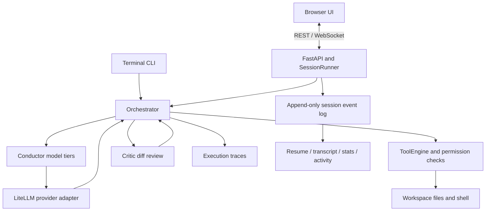

# Loom — Agentic Coding Harness

A Python coding agent with a terminal CLI and a local browser interface. Loom connects model tool calls to file operations, shell commands, permission prompts, checkpointing, and a separate critic review. It records execution so developers can inspect decisions and replay a task.

**Status:** working local prototype. On October 2, 2026, all **132 offline tests** passed, Ruff passed, the Python wheel built, and the browser UI and API started successfully on Windows with Python 3.11.4. Live provider calls and benchmark performance were not verified in this review. See [the verification report](docs/VERIFICATION.md) for evidence and limits.

## What it demonstrates

- **Agent orchestration:** a model → tools → results loop with bounded steps, cost accounting, and injectable model responses for offline testing.
- **Model tiers:** a workhorse model, a stronger model selected after tool failures or critic rejection, and a separate reviewer model. The current router is rule based.
- **Permissions and recovery:** file edits and shell commands prompt for approval, file writes show diffs, and checkpoints support `/rewind` for tracked file changes.
- **Critic feedback:** the reviewer examines the turn's diff and can request revisions. Edits have already been applied when review happens; the critic is not a transactional pre-write gate.
- **Inspectability:** JSONL traces capture model responses, tools, usage, and review decisions. Replay re-executes tools; `--fork-at` continues from recorded calls with a live model.
- **Local UI:** FastAPI, WebSockets, and a vanilla JavaScript interface provide sessions, tool activity, permission controls, artifacts, settings, and usage summaries.
- **Session infrastructure:** the UI session runner adds an append-only event log, resume, context compaction, prompt queues, background jobs, task tracking, project memory, hooks, deferred tools, and subagent sidechains. The CLI shares the core loop but does not expose all these UI integrations.
- **Evaluation:** three small task fixtures and a scored harness report success, steps, elapsed time, and estimated cost. These are starter evaluations, not a published benchmark.

## Quick start

Requires **Python 3.11+** and Git. Tests and the offline demo need no API key. Live tasks need a compatible provider account and model access.

```bash
git clone https://github.com/KTiwari05/Loom_Agentic_Harness.git
cd Loom_Agentic_Harness
python -m venv .venv
```

Activate the environment:

```powershell
# Windows PowerShell
.\.venv\Scripts\Activate.ps1
```

```bash
# macOS / Linux
source .venv/bin/activate
```

Install and verify:

```bash
python -m pip install -e ".[dev]"
python -m pytest -q
python scripts/demo_v2.py
```

Open the app:

```bash
loom ui
```

The UI runs at **http://127.0.0.1:8763**. Open **Customize**, enter your own provider key, and choose a matching LiteLLM model ID. Alternatively, copy `.env.example` to `.env` and configure it there. The template uses `openrouter/moonshotai/kimi-k2`; availability depends on the provider. No credentials are included in the repository.

```bash
# Interactive CLI in a project
loom --dir /path/to/project

# One task (approval prompts remain enabled)
loom --dir /path/to/project "add a slugify function and tests, then run the tests"

# Server without automatically opening a browser
loom ui --no-open --port 8763
```

See [QUICKSTART.md](QUICKSTART.md) for configuration, slash commands, replay, and the optional native desktop window.

## Architecture



The model adapter is injectable, allowing tests to drive real tools and server flows without calling a provider. The UI derives session views from event records; the CLI also maintains execution traces. See [docs/ARCHITECTURE.md](docs/ARCHITECTURE.md) for the implementation map and tradeoffs.

## Repository map

| Path | Purpose |
| --- | --- |
| `src/loom/orchestrator.py` | Core agent loop and critic feedback |
| `src/loom/models.py`, `conductor.py` | Provider responses, usage, and model selection |
| `src/loom/tools/` | Tool schemas, execution, files, search, shell, and subagents |
| `src/loom/checkpoints.py`, `replay.py` | File recovery and recorded execution |
| `src/loom/server/` | Local API, session runner, event-derived views, and static UI |
| `src/loom/eventlog.py`, `context.py`, `compaction.py` | Session records and context reconstruction |
| `tests/` | Offline unit and integration tests |
| `evals/` | Small task suite and evaluation runner |
| `scripts/` | Offline demo and Windows desktop build helpers |
| `docs/` | Current implementation notes and original design plans |

## For reviewers

1. Run `python -m pytest -q` to exercise tools, permission handling, critic revision, replay (including a subagent), event integrity, session resume, compaction, queues, memory, and WebSocket interactions.
2. Run `python scripts/demo_v2.py` for a short offline tour of the event-driven session components.
3. Inspect `orchestrator.py`, `server/bridge.py`, and `tests/test_server.py` to follow an agent turn from a user message through approval and file creation.
4. Read [evals/README.md](evals/README.md) before running live evaluations. No success rate or cost-reduction benchmark is claimed here.

## Limits and operating assumptions

- This is a **local, single-user prototype**, not a hosted multi-user service. The server binds to loopback and has no authentication layer.
- Permission prompts and workspace path checks are not an OS sandbox. Approved shell commands can affect resources outside the project. Use a disposable project for experiments.
- Critic review is bounded and may be skipped or fail; completion does not guarantee approval or correctness. Check tests and diffs yourself.
- `/rewind` restores tracked file writes, not arbitrary shell side effects. Replay runs tools again and should use a fresh workspace copy.
- The UI runner serializes agent work because tools rely on process-wide working-directory state. Sessions do not execute independent agent turns concurrently.
- Cost figures are estimates from provider metadata. The savings display compares token usage with a configurable price baseline; it does not measure equivalent task quality or prove a savings factor. Step and cost guards do not enforce a hard provider spending cap across every auxiliary call.
- Live model compatibility, a fresh Windows executable build, native-window behavior, and macOS/Linux execution remain unverified in the current review.

The [documentation index](docs/README.md) distinguishes current behavior from roadmap ideas such as learned difficulty routing, AST-aware retrieval, and OpenTelemetry integration.
